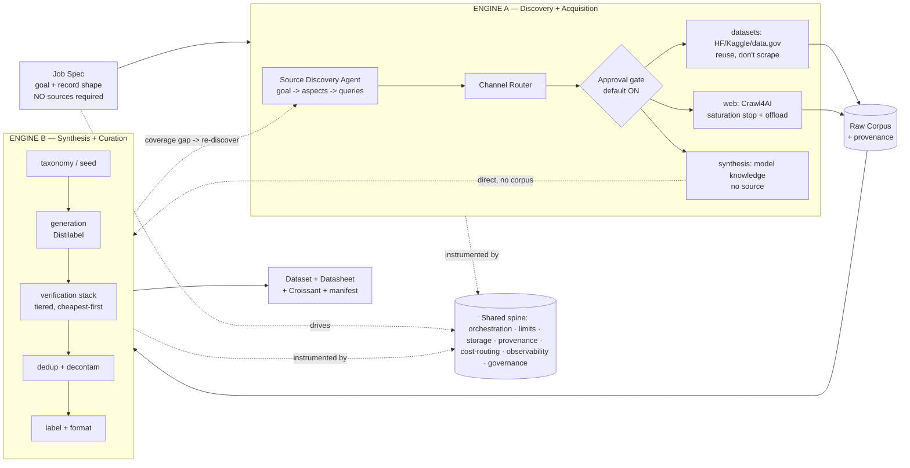

# Agentic Dataset Generation Harness — Project Outline

> A system that turns a one-line data goal + a [Job Spec](./PHASE0-CONTRACT.md) into a
> **structured, deduplicated, verified, training-ready dataset** with provenance — at scale.

## The core reframe

The original (Gemini) design is an excellent **acquisition** design but solves only the easy,
commoditized half: crawling the web. It also assumed the user *hands it sources* — but the user's
whole reason for needing this system is that **they don't know where the data is.** So Engine A leads
with **source discovery**, and a pile of scraped markdown is not a dataset — the value and the hard
engineering live in the transform from raw corpus → verified records. The system is **two engines on
one shared spine**:

See [`diagrams/architecture.drawio`](./diagrams/architecture.drawio) for the full editable diagram.

## Reuse-first stance (per the research)

Most of the curation/judging logic should **not** be hand-built. Buy-vs-build summary
(full analysis in [`RESEARCH.md`](./RESEARCH.md)):

| Concern | Decision | Tool |
|--------|----------|------|
| Source discovery (the intelligent core) | **Build** (glue) | deepagents research loop over search + registry APIs — *this is the differentiator* |
| Existing-dataset search | **Reuse** | HF Hub API (`huggingface_hub`), Kaggle API, data.gov / CKAN APIs |
| Crawl + search | **Reuse** | Crawl4AI (ships an official MCP server; `AdaptiveCrawler` for saturation stop) |
| Long-running agent harness | **Reuse** | `deepagents` on LangGraph (virtual FS, subagents, checkpointing) |
| MCP tool loading | **Reuse** | `langchain-mcp-adapters` `MultiServerMCPClient` |
| Generate + judge | **Reuse** | Distilabel (`Pipeline`/`Task`/`LLM`, `UltraFeedback`) |
| CPU dedup / clean / filter | **Reuse** | `datatrove` (MinHash 4-stage, `Document`/`PipelineStep`) |
| GPU dedup / PII / quality at scale | **Optional** | NeMo Curator (`FuzzyDuplicates`, `SemDedup`, `PIIRedactor`) — only if GPU |
| Human-in-the-loop review | **Reuse** | Argilla (`*ToArgilla` steps + suggestion injection) |
| Dataset exploration model | **Borrow concepts only** | Lilac (archived 2025-07-25 — do not depend on code) |

**The "build" surface is mostly orchestration glue** tying these together + the Phase 0 contract +
the tiered verification router + provenance.

---

## Phase 0 — Framing & contracts ✅ LOCKED
See [`PHASE0-CONTRACT.md`](./PHASE0-CONTRACT.md).
- **0.1** Verifiability tiers (hard / soft / hybrid) as a first-class job parameter
- **0.2** The **Job Spec** contract (Pydantic + JSON Schema + cross-field invariants)
- **0.3** The **Record Schema** (payload + PROV/MLMD provenance)
- **0.4** Validation strategy (boundary validation, `x-verifier` hook, dead-letter)
- **0.5** Auto-emitted docs (Datasheet, Croissant, manifest, dataset card, lineage)
- **0.6** Reuse audit (table above)

---

## Phase 1 — Engine A: Discovery + Acquisition
> Output: a **Raw Corpus** in object storage, every chunk carrying source provenance — *after* the
> system has figured out **where** to get the data. (Synthesis-channel jobs skip the corpus entirely.)

- **1.0 Source Discovery Agent** *(the intelligent core — the reason this isn't just a scraper)*
  - The user submits a goal + record schema, **not sources.** This stage answers "where does this
    data live?" as a deepagents research loop:
    1. **Decompose** the goal into aspects/sub-topics (feeds the Phase 2.1 taxonomy too).
    2. **Route by channel** per aspect — `datasets` (search HF Hub / Kaggle / data.gov and *reuse*) →
       `web` (crawl when no ready dataset) → `synthesis` (generate directly when the model already
       knows the domain). Order = reuse > crawl > synthesize.
    3. **Generate diverse queries**, run search + registry lookups, collect candidate sources.
    4. **Evaluate** each candidate against the spec: sample it — *does it actually contain records
       matching the target shape?* + quality + license (`allowed_licenses`) + freshness + yield.
    5. **Rank + dedupe** sources → a fetch plan.
  - **Approval gate (default ON):** present the ranked source list + reasoning; wait for "go".
    `discovery.approval_gate=false` runs autonomous.
  - **Coverage-gap re-discovery:** when Engine B reports thin coverage on an aspect, this stage wakes
    back up and finds more sources for *that* aspect. Discovery is a loop, not a one-shot.
  - **Modes:** `auto` (goal only), `seeded` (expand from hints), `fixed` (exact sources given).

- **1.1 Crawl4AI MCP microservice** *(the `web` channel)*
  - Stand up the official Crawl4AI MCP server (Docker; **SSE at `/mcp/sse`**, schemas at `/mcp/schema`).
  - Confirm exposed tools (`md`, `html`, `screenshot`, `pdf`, `execute_js`, `crawl`, `ask`); add a thin
    `search_and_discover` wrapper over a meta-search provider (SearXNG / Brave) if not present.
  - Browser worker pool (Playwright), `ProxyConfig` rotation, `browser_type="undetected"`.
  - **Transport note:** the official server is SSE/WS; `langchain-mcp-adapters` prefers
    `streamable_http`. Either point the adapter at `transport: "sse"` / `/mcp/sse`, or front the
    service with a streamable-http server. (Decide + document.)
- **1.2 deepagents coordinator + web-scout subagents**
  - `create_deep_agent(model=..., tools=<mcp tools>, subagents=[web_scout], system_prompt=...)`
    — note current API: **`system_prompt`** (not `instructions`), **`subagents`**, model default `None`.
  - Load MCP tools via `MultiServerMCPClient({...}).get_tools()`.
  - Use built-in `write_todos` (plan) + `task` (spawn isolated subagents) + virtual FS.
- **1.3 Context-offload pattern**
  - Heavy payloads → S3/MinIO; return **URI + preview**, never raw text into context.
  - Crawl4AI `PruningContentFilter` / `BM25ContentFilter` → `fit_markdown` before it leaves the service.
- **1.4 Stopping: coverage-saturation primary, hard-limit floor**
  - **Primary signal:** `AdaptiveCrawler` (coverage / consistency / **saturation**, `confidence_threshold≈0.7`)
    — stop a topic when new pages stop adding novel information.
  - **Floor:** the two-layer circuit breaker from the thread (MCP tool-layer check + LangGraph
    conditional router → graceful `compile_corpus` node + manifest + exit reason).
- **1.5 Durable execution**
  - LangGraph `checkpointer` (resumable) + `store` (cross-thread memory); dead-letter on fatal errors.
- **1.6 Existing-dataset channel** *(the `datasets` channel — usually the highest-yield path)*
  - Search HF Hub (`huggingface_hub`), Kaggle, data.gov/CKAN; filter by license + relevance;
    download and normalize into the corpus instead of re-scraping. Stamp `source_channel="datasets"`.
- **1.7 Synthesis hand-off** *(the `synthesis` channel)*
  - When discovery routes an aspect to `synthesis`, there is **no corpus** — it flows straight to
    Engine B generation (Phase 2.2) seeded by the goal/taxonomy. Records stamp `source_channel="synthesis"`.

**Acceptance:** given only a goal + record schema (no sources), Engine A discovers and ranks sources,
gets approval, fetches via the right channel, produces a provenance-tagged corpus (or hands synthesis
jobs to Engine B), stops on saturation, never exceeds limits, and resumes cleanly after a kill.

---

## Phase 2 — Engine B: Synthesis & Curation (the missing half)
> Output: candidate records → **verified, deduplicated, formatted dataset records**.

- **2.1 Taxonomy / seed engine** *(diversity is the systemic risk — mode collapse is real)*
  - Structured sampling space: personas + topics + difficulty + constraints.
  - Strategies: **Self-Instruct** (ROUGE-L < 0.7 novelty gate), **Evol-Instruct** (in-depth +
    in-breadth evolving, elimination of no-gain evolutions), **Persona Hub** (persona-conditioned).
  - **Accumulate** real + synthetic; track coverage against the taxonomy (don't chase volume).
- **2.2 Record generation**
  - Distilabel `Pipeline` → `Task` (e.g. `TextGeneration`) → `LLM`; corpus chunks as the load step.
  - Ground generation in the corpus (retrieval) for soft-verifiable knowledge data.
- **2.3 Verification stack — tiered, cheapest-first** *(reject early; escalate only survivors)*
  1. exact-hash / substring dedup (≥50 tokens)
  2. heuristic quality filters (Gopher/C4: length, symbol ratio, repetition, stop-words) — *audit dialect skew*
  3. **n-gram decontamination** vs held-out eval sets *(mandatory before any eval split)*
  4. MinHash + LSH near-dedup (5-gram, **0.8 Jaccard, per-shard**)
  5. **deterministic verifier** (sympy / sandboxed unit tests / schema) — *whole check for Tier 1, gate for Tier 3*
  6. model-based quality classifier (FineWeb-Edu-style embed + linear head / fastText)
  7. semantic dedup (SemDeDup) + embedding-based decontamination
  8. **LLM-as-jury** (rubric + position-swap + **disjoint-family panel** + length-control + reference-guided) — *Tier 2, and Tier 3 residual only*
  9. LLM-based paraphrase decontamination — *eval splits only, final gate*
  - Router selects the sub-graph per `verifiability_tier`. Verifiers are treated as **adversarially
    gameable** → isomorphic-perturbation tests + negative controls.
- **2.4 Dedup + diversity + contamination subsystem** *(first-class, not a footnote)*
  - datatrove MinHash pipeline (signature → buckets → cluster → filter); record `dedup_cluster_id`.
  - Train/test leakage guard: n-gram + paraphrase decontamination, `contamination_flag` per record.
- **2.5 Label / structure / format**
  - Validate against `record_schema_ref`; quarantine failures to dead-letter with the error attached.

**Acceptance:** every accepted record validates against the schema, carries judge/verifier results,
a dedup cluster id, and a contamination flag; coverage metrics reported against the taxonomy.

---

## Phase 3 — Shared spine (cross-cutting)
- **3.1 Orchestration & state** — LangGraph; idempotent steps; resumption; dead-letter; global
  metrics reducers (`pages_scraped`, `tokens_used`, `cost_usd`).
- **3.2 Cost & model routing** — bulk generation on cheap/local models (Qwen-Coder/Llama via vLLM);
  escalate hard cases + judging to frontier models; PoLL judge panel is *cheaper* than one big judge.
  (This is the `/model-route` heuristic applied at data scale.)
- **3.3 Provenance & lineage** — per-record PROV/MLMD columns + `lineage.json` export.
- **3.4 Observability** — **$/accepted-record**, accept rate, coverage saturation, quality drift,
  judge-agreement rate; dashboards.
- **3.5 Governance & HITL** — license/PII enforcement (`pii_policy`), Argilla review surface for
  escalated/low-confidence records (Distilabel `*ToArgilla` + suggestion injection).
- **3.6 Reproducibility** — seeds, prompt hashes, config snapshots; versioning via DVC / HF Datasets.

---

## Phase 4 — Delivery & evaluation
- **4.1 Output** — JSONL/Parquet + `manifest.jsonl` + auto `datasheet.md` + `croissant.json` + dataset card.
- **4.2 Dataset-quality evals** — diversity metrics, contamination report, and **downstream task lift**
  (the only evaluation that ultimately matters: does training on it help?).
- **4.3 Packaging / publishing** — push to `distribution_target` (HF Hub / GCS / local) with the
  license stamped and access controls applied.

---

## Suggested build order (dependency-aware)

1. **Phase 0** ✅ (done — contract locked)
2. **Phase 1.1–1.3** (Crawl4AI MCP + deepagents + offload) — the first microservice you wanted
3. **Phase 1.0** (Source Discovery Agent + approval gate) — built on the same deepagents loop; the
   intelligent core. Start with `web` + `datasets` channel routing.
4. **Phase 3.1 + 3.3** (minimal orchestration + provenance) — needed for Phase 1 to be auditable
5. **Phase 1.4–1.7** (saturation stop + durability + dataset channel + synthesis hand-off)
6. **Phase 2.1–2.3** (seed → generate → tiered verify) — the value-creating half
7. **Phase 2.4–2.5 + 3.2/3.4/3.5** (dedup/decontam + routing + observability + HITL)
8. **Phase 4** (delivery + downstream-lift eval)

## Top risks (and where they're handled)

| Risk | Handled in |
|------|-----------|
| User doesn't know sources / discovery picks bad ones | 1.0 discovery loop + candidate evaluation + **approval gate** + coverage-gap re-discovery |
| Re-scraping data that already exists as a dataset | 1.0 channel order (datasets > web) + 1.6 registry search |
| Mode collapse / low diversity | 2.1 taxonomy + accumulate, observability coverage metric |
| Benchmark contamination | 2.3 step 3 + 2.4 + 0.3 mandatory decontam invariant |
| Verifier gaming (Tier 1/3) | 0.2 isomorphic-perturbation tests + negative controls |
| LLM-judge bias (Tier 2/3) | 0.2 / 2.3 position-swap + disjoint-family panel + length-control |
| Over-dedup destroying quality | 0.3 per-shard default + warning on global scope |
| Runaway cost / infinite loop | 1.4 circuit breaker floor + 3.2 cost routing + `max_cost_usd` |
| Stale library APIs | RESEARCH §APIs (deepagents `system_prompt`, `MultiServerMCPClient`, SSE transport) |
