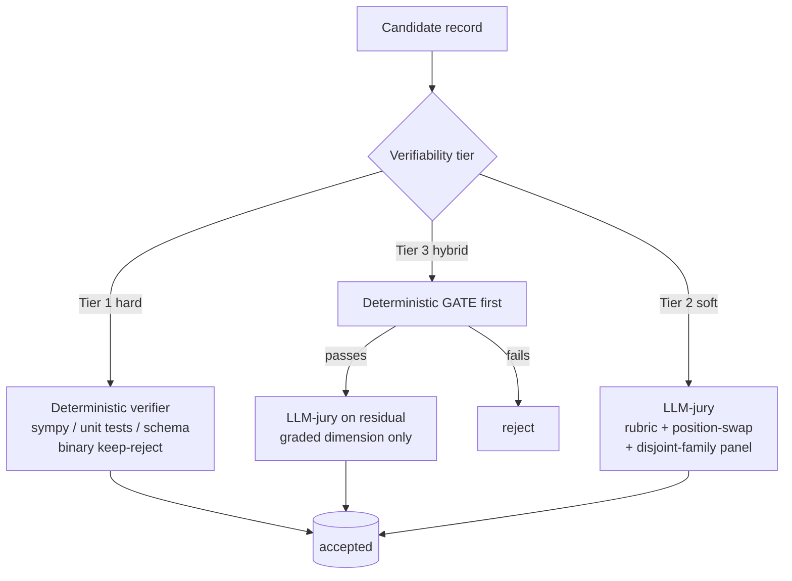

# Phase 0 — The Contract (LOCKED)

> **Status:** locked baseline · **Date:** 2026-06-13
> Everything downstream (the scraper, the generator, the verifier, the storage layer) is built
> against the two contracts defined here. If the scraper does not know *what record it is collecting
> for*, it optimizes for "pages" instead of "useful records" — so this is locked first, even though
> Engine A (acquisition) is built first.

This document defines three things:

1. **The verifiability tier** — a first-class job parameter that changes how the quality loop runs.
2. **The Job Spec** — what a user submits to request a dataset build.
3. **The Record Schema** — the shape of one emitted record, including provenance.

Every field is grounded in an external standard; see [`RESEARCH.md`](./RESEARCH.md) for full citations.

---

## 0.1 Why a contract at all

A dataset is **not** a pile of scraped markdown. The value is in the transform from raw corpus →
*structured, deduplicated, verified, training-ready records with provenance*. Two parties need a
stable interface between them:

- **The requester** states the **goal**, the target record shape, the verifiability tier, limits, and
  distribution — **but not necessarily where the data lives.** Finding sources is the harness's job
  (see §0.3 `discovery`). (the Job Spec)
- **The harness** guarantees every emitted record matches a schema and carries enough lineage to be
  audited, decontaminated, versioned, and shipped with a datasheet. (the Record Schema)

> **Discovery-first (the whole point).** The user needs this system *precisely because they don't know
> where the data is.* So `sources` are **never mandatory** — the system discovers them from the goal
> across three channels — **existing datasets** (reuse before scraping) · **web crawl** · **pure
> synthesis** (generate when the model already knows the domain) — and, by default, shows you the
> ranked candidate sources for approval before fetching anything.

The Job Spec also **doubles as the source of the auto-generated Datasheet + Croissant metadata** at
build end — so documentation is a byproduct, not an afterthought.

---

## 0.2 Verifiability tiers (the axis that drives everything)

A task's tier is decided by **what kind of oracle can decide correctness**. This is the single most
important parameter in the spec because it changes the entire quality loop.



| Tier | Definition | Examples | Quality loop | Tier-specific risk + mitigation |
|------|-----------|----------|--------------|----------------------------------|
| **1 — Hard-verifiable** | A deterministic function decides correctness | math (exact/symbolic match), code (unit tests in a sandbox), schema/constraint validation, execution-checked SQL | Generate → run verifier → binary keep/reject. **No LLM judge needed for correctness.** | Verifier gaming / extensional-only checks. Mitigate with **isomorphic-perturbation tests** of the verifier and **negative controls** (verifier must reject known-bad gold). |
| **2 — Soft-verifiable** | No deterministic oracle; quality is graded | open-ended generation, summarization, helpfulness/tone, creative writing | Generate → **LLM-as-jury** with explicit rubric, **position-swapped** pairwise, reference-guided where a gold exists. | Judge bias (position, verbosity, self-preference). Mitigate: require both-order agreement, **panel from disjoint model families (PoLL)**, length-controlled scoring, never self-judge. |
| **3 — Hybrid** | Checkable skeleton + subjective remainder | code that must pass tests *and* be readable; extraction that must validate *and* be faithful; "answer the constraint *and* explain well" | **Deterministic gate first** (cheap hard reject) → only survivors reach the **Tier-2 jury** for the graded dimension. | Same as Tier 2 but volume-reduced. The gate slashes judge cost and removes confidently-wrong items judges mis-grade. |

The spec field is `verifiability_tier: 1 | 2 | 3`. The harness wires a different verification
sub-graph per tier (see [`OUTLINE.md`](./OUTLINE.md) Phase 2.3 and the cheapest-first stack in
[`RESEARCH.md`](./RESEARCH.md) §QC).

---

## 0.3 The Job Spec

What a requester submits. Grounded in **Datasheets for Datasets** (§Motivation/Uses/Distribution),
**HF dataset-card** YAML, **Croissant** dataset-level metadata, and **Distilabel** generation params.

### 0.3.1 YAML shape (human-authored)

```yaml
# === Identity & intent  (Datasheets §1 Motivation, §5 Uses) ===
job_id:            "uuid"            # assigned by the harness if omitted
name:              "rust-async-macro-patterns"
description:       "Q/A pairs on advanced Rust async macro design, harvested + synthesized from the web."
motivation:        "SFT data to teach a model idiomatic async macro patterns."
intended_uses:     ["supervised-fine-tuning"]
out_of_scope_uses: ["safety evaluation", "factual benchmark"]

# === Task & content shape  (HF card + Croissant) ===
verifiability_tier: 2               # 1 hard | 2 soft | 3 hybrid  <-- drives the quality loop
task_categories:   ["question-answering", "text-generation"]
languages:         ["en"]
modality:          "text"           # text | code | image | audio | tabular | multimodal
target_size:       { records: 25000 }
record_schema_ref: "./schemas/qa_record.schema.json"   # JSON Schema the output MUST satisfy

# === Discovery: WHERE to get the data — the SYSTEM figures this out  ===
# The user states the GOAL above; sources are discovered. `seeds` are OPTIONAL hints, not requirements.
discovery:
  mode:           "auto"            # auto (default) | seeded | fixed
  seeds:          []                # OPTIONAL starting points — e.g. ["https://docs.rs/"] — never required
  approval_gate:  true              # pause to review ranked sources before fetch (set false to run autonomous)
  channels:       ["datasets", "web", "synthesis"]   # tried in this order: reuse > crawl > synthesize; add "media" for stock-video jobs
  constraints:                      # OPTIONAL guardrails — NOT a list of where to look
    include_domains: []
    exclude_domains: ["reddit.com"]
    recency_after:   "2022-01-01"
    respect_robots_txt: true
allowed_licenses:  ["CC-BY-4.0", "CC0-1.0", "MIT", "Apache-2.0", "public-domain"]
pii_policy:        "redact"          # redact | drop | allow

# === Generation config  (Distilabel) ===
generator_models:  ["anthropic:claude-haiku-4-5", "qwen2.5-coder:32b-vllm"]   # bulk = cheap/local
judge_config:
  models:          ["anthropic:claude-sonnet-4-6", "openai:gpt-judge"]        # disjoint families
  rubric_ref:      "./rubrics/qa_helpfulness.md"
  min_score:       3.5               # 0–5 scale
  position_swap:   true
generation_params: { temperature: 0.7, top_p: 1.0, max_tokens: 1024, seed: 42 }
diversity_strategy: "persona+evol"   # self-instruct | evol-instruct | persona | persona+evol
dedup_policy:      { method: "minhash", ngram: 5, jaccard: 0.8, scope: "per-shard" }
decontaminate_against: ["./eval/heldout_rust_qa.jsonl"]   # n-gram + paraphrase scan

# === Output & distribution  (HF card + Datasheets §6/§7) ===
output_format:     "parquet"         # jsonl | parquet
splits:            { train: 0.9, validation: 0.05, test: 0.05 }
output_license:    "CC-BY-4.0"
distribution_target: "hf://my-org/rust-async-macro-patterns"
maintainer:        "uttkrisht@brilo.ai"
emit_datasheet:    true              # generate Datasheet + Croissant at build end

# === Limits (circuit breaker floor; coverage-saturation is the primary stop) ===
limits:
  max_pages_scraped: 5000
  max_llm_tokens:    50000000
  max_storage_mb:    20000
  max_runtime_seconds: 28800
  max_cost_usd:      250
```

### 0.3.2 Pydantic model (machine contract)

```python
from enum import IntEnum, Enum
from pydantic import BaseModel, Field, HttpUrl
from datetime import datetime

class VerifiabilityTier(IntEnum):
    HARD = 1; SOFT = 2; HYBRID = 3

class DiscoveryMode(str, Enum):
    AUTO = "auto"                      # user gives only the goal; system discovers sources
    SEEDED = "seeded"                  # user gives hints; system expands from them
    FIXED = "fixed"                    # user gives exact sources (degenerate; just fetch)

class SourceChannel(str, Enum):
    DATASETS = "datasets"              # HF Hub / Kaggle / data.gov — reuse, don't re-scrape
    WEB = "web"                        # Crawl4AI crawl
    MEDIA = "media"                    # licensed stock-video download (Pexels et al.) — added post-Phase-0
    SYNTHESIS = "synthesis"            # generate from model knowledge, no external source

class DiscoveryConstraints(BaseModel):
    include_domains: list[str] = []
    exclude_domains: list[str] = []
    recency_after: str | None = None
    respect_robots_txt: bool = True
    media_min_duration_s: float | None = None   # media-channel acquisition filters
    media_max_duration_s: float | None = None
    media_orientation: str | None = None        # landscape | portrait | square

class Discovery(BaseModel):
    mode: DiscoveryMode = DiscoveryMode.AUTO
    seeds: list[str] = []              # OPTIONAL hints — the user need not know ANY source
    approval_gate: bool = True         # review ranked sources before fetch (False = autonomous)
    channels: list[SourceChannel] = [SourceChannel.DATASETS, SourceChannel.WEB, SourceChannel.SYNTHESIS]
    constraints: DiscoveryConstraints = DiscoveryConstraints()

class JudgeConfig(BaseModel):
    models: list[str]                  # MUST be >=2 disjoint families for Tier 2/3
    rubric_ref: str | None = None
    min_score: float = Field(3.5, ge=0, le=5)
    position_swap: bool = True

class Limits(BaseModel):
    max_pages_scraped: int = 5000
    max_llm_tokens: int = 50_000_000
    max_storage_mb: int = 20_000
    max_runtime_seconds: int = 28_800
    max_cost_usd: float = 250.0

class DedupPolicy(BaseModel):
    method: str = "minhash"            # minhash | exact | semantic
    ngram: int = 5
    jaccard: float = Field(0.8, ge=0, le=1)
    scope: str = "per-shard"           # per-shard (recommended) | global

class JobSpec(BaseModel):
    job_id: str | None = None
    name: str
    description: str
    motivation: str
    intended_uses: list[str]
    out_of_scope_uses: list[str] = []

    verifiability_tier: VerifiabilityTier
    task_categories: list[str]
    languages: list[str]
    modality: str = "text"
    target_size: dict                  # {"records": int} or {"tokens": int}
    record_schema_ref: str             # path/URI to JSON Schema

    discovery: Discovery = Discovery() # WHERE to get data is DISCOVERED, not required from the user
    allowed_licenses: list[str]
    pii_policy: str = "redact"         # redact | drop | allow

    generator_models: list[str]
    judge_config: JudgeConfig | None = None
    generation_params: dict = {}
    diversity_strategy: str = "persona+evol"
    dedup_policy: DedupPolicy = DedupPolicy()
    decontaminate_against: list[str] = []

    output_format: str = "parquet"     # jsonl | parquet
    splits: dict = {"train": 0.9, "validation": 0.05, "test": 0.05}
    output_license: str
    distribution_target: str | None = None
    maintainer: str | None = None
    emit_datasheet: bool = True

    limits: Limits = Limits()
```

**Cross-field invariants the validator must enforce (fail-fast at submission):**

- `verifiability_tier in {2,3}` ⇒ `judge_config.models` has **≥2 distinct model families** (PoLL).
- `verifiability_tier == 1` ⇒ `record_schema_ref` declares a deterministic verifier hook
  (a `x-verifier` extension on the schema, see §0.5).
- any split named `test`/`validation` ⇒ `decontaminate_against` is non-empty
  (decontamination is **mandatory** before anything enters an eval split).
- `output_license` must be compatible with every entry actually retained in `allowed_licenses`.
- `dedup_policy.scope == "global"` emits a **warning** (global MinHash can delete higher-quality
  recurring content — dedup per-shard by default; see RESEARCH §QC).
- `discovery.mode == "fixed"` ⇒ `discovery.seeds` is non-empty (fixed mode needs the explicit sources).
- `discovery.mode in {"auto","seeded"}` ⇒ `seeds` is **optional** — the user need not know any source.
- `discovery.channels == ["synthesis"]` ⇒ no acquisition runs at all; records are generated directly
  from model knowledge (corpus stays empty — a valid path, not an error).

---

## 0.4 The Record Schema

One emitted record. Payload + full lineage. Provenance fields map directly onto **W3C PROV**
(Entity/Activity/Agent) and **MLMD** (Artifact/Execution/Context), and follow **Distilabel** and
**Data Provenance Initiative** conventions.

### 0.4.1 Canonical record (JSONL line / Parquet row)

```jsonc
{
  // --- identity ---
  "record_id":   "uuid",              // PROV Entity / MLMD Artifact
  "job_id":      "uuid",              // PROV Context / MLMD Context
  "split":       "train",             // cr:Split

  // --- payload (the actual training content; shape varies by record_schema_ref) ---
  "input":       "How do I write a declarative macro that...",
  "output":      "Use `macro_rules!` with a `$($t:tt)*` repetition...",

  // --- source lineage  (PROV wasDerivedFrom / used) ---
  "source_channel": "web",            // datasets | web | synthesis  (source_url is null when synthesis)
  "source_url":     "https://docs.rs/...",
  "source_license": "CC-BY-4.0",
  "source_sha256":  "…",              // Croissant FileObject.sha256
  "derived_from":   ["record_id|corpus_chunk_id|dataset_id"],

  // --- generation lineage  (PROV wasGeneratedBy / wasAttributedTo) ---
  "model_id":          "anthropic:claude-haiku-4-5",   // PROV Agent / distilabel model_name
  "prompt_hash":       "sha256:…",    // raw prompt kept in side-store keyed by hash
  "system_prompt_hash":"sha256:…",
  "generation_params": { "temperature": 0.7, "top_p": 1.0, "seed": 42 },
  "generated_at":      "2026-06-13T10:22:31Z",         // PROV generatedAtTime
  "pipeline_step":     "text-generation",              // MLMD Execution / distilabel STEP_NAME

  // --- quality + dedup ---
  "verifiability_tier": 2,
  "verifier_result":    null,         // Tier 1/3: {"passed": true, "detail": "..."}
  "judge_scores":       { "helpfulness": 4, "honesty": 5, "overall": 4 },
  "judge_models":       ["anthropic:claude-sonnet-4-6", "openai:gpt-judge"],
  "dedup_cluster_id":   "cluster-123",
  "is_duplicate":       false,
  "contamination_flag": false,        // tripped by n-gram / paraphrase decontam vs held-out

  // --- accounting ---
  "input_tokens":  128,
  "output_tokens": 256,
  "language":      "en",
  "task_category": "question-answering",
  "cost_usd":      0.0009
}
```

### 0.4.2 Pydantic model

```python
class VerifierResult(BaseModel):
    passed: bool
    detail: str | None = None

class Record(BaseModel):
    record_id: str
    job_id: str
    split: str

    input: str
    output: str
    media: MediaRef | None = None     # acquired-asset ref (video jobs); None for text/code

    source_channel: SourceChannel = SourceChannel.WEB   # datasets | web | media | synthesis
    source_url: HttpUrl | None = None                   # null for synthesis
    source_license: str = "unknown"
    source_sha256: str | None = None
    derived_from: list[str] = []

    model_id: str
    prompt_hash: str
    system_prompt_hash: str | None = None
    generation_params: dict = {}
    generated_at: datetime
    pipeline_step: str

    verifiability_tier: VerifiabilityTier
    verifier_result: VerifierResult | None = None     # required for tier 1/3
    judge_scores: dict[str, float] | None = None       # required for tier 2/3
    judge_models: list[str] = []
    dedup_cluster_id: str | None = None
    is_duplicate: bool = False
    contamination_flag: bool = False

    input_tokens: int = 0
    output_tokens: int = 0
    language: str = "en"
    task_category: str | None = None
    cost_usd: float = 0.0
```

> **Design note — large/sensitive prompts.** Store `prompt_hash` inline; keep the raw prompt in a
> side-store keyed by hash (mirrors Distilabel's toggleable `add_raw_input`). Keeps records small,
> avoids leaking secrets into the dataset, and still gives full reproducibility.

### 0.4.3 Media extension (post-Phase-0 amendment)

Training-ready media datasets (image-to-video fine-tuning et al.) extend the canonical record:

```python
class MediaRef(BaseModel):          # Record.media; None for text/code jobs
    role: str = "video"
    path: str                       # dataset-dir-relative, content-addressed: media/<sha256>.<ext>
    sha256: str
    bytes: int
    duration_s: float | None = None
    width: int | None = None
    height: int | None = None
    fps: float | None = None
    format: str = "mp4"
    attribution: str | None = None
```

* **Channel**: `SourceChannel.MEDIA` acquires licensed stock clips (Pexels first) into a
  content-addressed staging tree (`media_staging/<job_id>/<sha256>.<ext>`) under
  `limits.max_storage_mb`; unknown-license clips are quarantined like any other source.
* **Verification**: the video-caption record schema declares an `x-verifier` media-probe hook
  (re-hash + re-probe of the staged file); captions are graded by the jury as usual.
* **Delivery**: `JobSpec.delivery_layout` selects a registered trainer-facing bundle builder from
  `adh.delivery.layouts` (`"hf"` default, `"ltx"` for LTX-Video-style trainers; extensible via
  `register_layout`). Asset files are appended to the delivery manifest as `kind:"asset"` rows so
  publish/croissant carry them automatically.
* Captions v1 come from source metadata; vision-model frame captioning and conditioning-frame
  extraction are designed-in TODO seams, not contract changes.

---

## 0.5 Validation strategy

- **Records** validate against the per-job JSON Schema referenced by `record_schema_ref`
  (`additionalProperties: false`, explicit `required`) AND the base `Record` Pydantic model.
- **Tier-1 verifier hook**: the JSON Schema carries an `x-verifier` extension naming a callable
  (`module:function`) and config; the harness imports and runs it as the deterministic gate.
  ```jsonc
  { "x-verifier": { "kind": "unit_tests", "entry": "verifiers.code:run_pytest", "timeout_s": 10 } }
  ```
- Validation runs **at the boundary** (record emission) — invalid records are quarantined to a
  dead-letter store with the `ValidationError` attached, never silently dropped.

---

## 0.6 Auto-emitted at build end (documentation as byproduct)

| Artifact | Built from | Standard |
|----------|-----------|----------|
| `datasheet.md` | Job Spec (Motivation/Uses/Distribution) + run stats (Composition/Collection) | Datasheets for Datasets |
| `croissant.json` | Job Spec + record schema + file manifest | MLCommons Croissant (JSON-LD) |
| `manifest.jsonl` | per-shard file list, counts, hashes, exit reason | internal |
| `README.md` (dataset card) | Job Spec + stats | HF dataset-card YAML frontmatter |
| `lineage.json` | per-record provenance graph | W3C PROV / MLMD |

---

## 0.7 Deliberately deferred (out of Phase 0 scope)

- **Supervising-LLM that derives limits from requirements** — Phase 0 takes hard limits in the input
  payload (the MVP contract you chose with Gemini). Auto-derivation is a later enhancement.
- **GitHub-code and structured-API source channels** — Phase 0 locks **datasets / web / synthesis**
  channels only; code-repo and API discovery are deferred to a later phase.
- **Multimodal record payloads** — schema supports `modality` but Phase 0 locks the **text/code**
  payload shape only.
- **Streaming/online dataset updates** — Phase 0 is batch-job oriented.
- **Marketplace / multi-tenant governance** — single-tenant assumed.

---

## 0.8 Open decisions for sign-off

1. **Payload generality.** Lock `input`/`output` as the canonical pair now, or model a more general
   `messages[]` (chat-style) payload from the start? (Recommendation: lock `input`/`output`; add a
   `messages` variant schema when a chat dataset job appears — YAGNI.)
2. **Provenance backend.** Emit lineage as a flat per-record column set (cheap, queryable) vs. a
   first-class PROV/MLMD store. (Recommendation: per-record columns now + a `lineage.json` export;
   adopt MLMD only if you later need cross-run artifact tracking.)
3. **License of `unknown`-license sources.** Hard-drop, quarantine, or allow-with-flag?
   (Recommendation: quarantine — never let `unknown` into a shipped split.)
